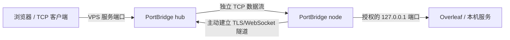

# PortBridge

简单配置的内网 TCP 转发工具：一个 Go 程序，VPS 运行 `hub`，内网服务器运行 `node`。适合把 Overleaf 等本机服务通过 VPS 端口提供访问。

- 一个命令安装，复制配对链接即可连接；不需要手工配置 FRP、令牌或节点清单。
- Azure 风格 WebUI 编译进二进制；运行不需要 Go、Python、npm、FRP 或外部数据库。
- 本机授权服务端口，VPS 自动分配或指定公网端口，支持暂停、恢复、删除、重启恢复与断线重连。
- 账号、节点身份、服务和数据独立；SSH 连接管理使用 [NodeBridge](https://github.com/johnfan12/NodeBridge)。



## 一键安装

Linux/systemd，支持 amd64 和 arm64。

**VPS：** 将 `你的VPS公网IP` 替换为实际 IP 或域名。

```bash
curl -fsSL https://github.com/johnfan12/PortBridge/releases/latest/download/install.sh | sudo bash -s -- hub --public-url https://你的VPS公网IP:9543
```

**内网服务器：**

```bash
curl -fsSL https://github.com/johnfan12/PortBridge/releases/latest/download/install.sh | sudo bash -s -- node
```

脚本下载对应架构并校验 SHA-256，配置专用 `portbridge` 用户和 systemd 服务。默认控制台 `https://VPS:9543`，本地维护页 `http://127.0.0.1:9900`。首次管理员账号为 `admin`，密码在安装输出和 `/var/lib/portbridge/hub/initial-admin.txt` 中；登录后可修改密码。默认自签证书，浏览器需核对服务器指纹；节点按配对链接中的指纹验证证书。

[最新发布与下载](https://github.com/johnfan12/PortBridge/releases/latest)

## 配对与转发 Overleaf

1. 登录 VPS 控制台，进入“管理页面” → “接入服务器”，填写节点名，生成一次性配对链接（15 分钟有效）。
2. 在节点执行 `portbridge pair`，粘贴 `portbridge://pair/...` 链接；有桌面时也可在节点维护页配对。
3. 确认本机服务可访问，例如 `curl http://127.0.0.1:8080`。在节点维护页展开“授权本机服务端口”，添加实际端口。
4. 返回 VPS 首页，点击“创建端口转发”，选择节点和已授权端口。名称填 `Overleaf`，访问方式选 HTTP，公网端口留空自动分配。
5. 放行分配的 VPS TCP 端口，点击“打开”或复制地址，例如 `http://VPS:40000`。

节点配对不占用公网服务端口，只有创建转发时才监听。SSH/维护 API 不需要暴露到公网。每节点最多授权 16 个本机端口，hub 最多接入 100 个节点和 100 个转发。

无桌面节点可通过本机 API 授权：

```bash
curl -fsS -X POST http://127.0.0.1:9900/api/tcp-ports \
  -H 'Content-Type: application/json' -H 'X-PortBridge-Request: 1' \
  -d '{"port":8080}'
```

Docker 服务需把宿主机端口发布到 `127.0.0.1`；目标不是容器内部端口。PortBridge 原样转发 TCP，支持 HTTP 上传和 WebSocket，不改写服务登录、Cookie、路径或重定向。Overleaf 对外站点地址需要在 Overleaf 自身配置中更新。

**控制台登录只保护管理功能；公网服务仍由 Overleaf 等后端自行鉴权。** 浏览器使用 HTTP 时，浏览器到 VPS 的链路为明文，VPS 到节点的隧道经 TLS 加密。本版不自动部署域名、Nginx 或证书；可自行在 VPS 配置 HTTPS 反向代理，后续再整合。

## 暂停、更新与卸载

VPS 首页可暂停/恢复单个转发；节点维护页可暂停/恢复本机全部转发，或撤销某个端口授权。暂停/撤销立即断开相应连接，Web 和配对保留，本机实际服务继续运行。暂停保留端口，删除才回收；删除节点同步删除其全部转发。两处开关独立，需要分别恢复。

更新重新执行对应的一键安装命令，保留配置、端口和数据库；更新重启会断开经过该服务的连接。PortBridge 的更新、暂停或卸载不操作 NodeBridge 服务。

**完整卸载（Web + 后端）：**

```bash
# 内网节点
curl -fsSL https://github.com/johnfan12/PortBridge/releases/latest/download/uninstall.sh | sudo bash -s -- node --purge
# VPS
curl -fsSL https://github.com/johnfan12/PortBridge/releases/latest/download/uninstall.sh | sudo bash -s -- hub --purge
```

`--purge` 永久删除对应模式的数据，不带该参数则保留；同机同时卸载 hub/node 使用 `all --purge`。卸载不会操作 Overleaf、系统 SSH 或 NodeBridge。

## 默认部署隔离

| 项目 | PortBridge | NodeBridge |
| --- | --- | --- |
| 用途 | Overleaf / 通用 TCP 转发 | SSH 连接 |
| VPS Web | 9543 | 9443 |
| 节点维护 | 9900 | 9899 |
| 公网端口池 | 40000–49999 | 30000–39999 |
| 程序 / 系统用户 | portbridge | nodebridge |
| systemd | portbridge-hub / portbridge-node | nodebridge-hub / nodebridge-node |
| 安装数据 | /var/lib/portbridge/hub 或 node | /var/lib/nodebridge/hub 或 node |
| 配对链接 | portbridge://pair/... | nodebridge://pair/... |

两者可以部署在同一 VPS 和节点上。配对、账号与凭证互不通用；不直接复制数据库或配置。首次 hub 需放行 Web 端口及实际服务端口，node 只需要主动连接 hub。

## 源码构建

需要 Go 1.26 或更新版本。生产使用 Release 二进制即可。

```bash
make check build
./bin/portbridge hub --public-url https://你的VPS公网IP:9543
./bin/portbridge node
make release VERSION=v0.1.0
```

手动运行默认数据目录 `./data/portbridge/hub` 和 `./data/portbridge/node`，首次管理员密码在 hub 目录。可用 `--data-dir`、`--listen`、`--port-start`、`--port-end` 指定首次配置；已有配置修改需停服并编辑 `config.json`。

从源码安装使用 `sudo bash scripts/install.sh hub --binary ./bin/portbridge --public-url https://VPS:9543`，节点改为 `node`。指定发布版本可通过 `PORTBRIDGE_RELEASE_BASE_URL` 覆盖下载地址。

[迁移说明](docs/MIGRATION.md) · [运维](docs/OPERATIONS.md) · [架构](docs/ARCHITECTURE.md)
